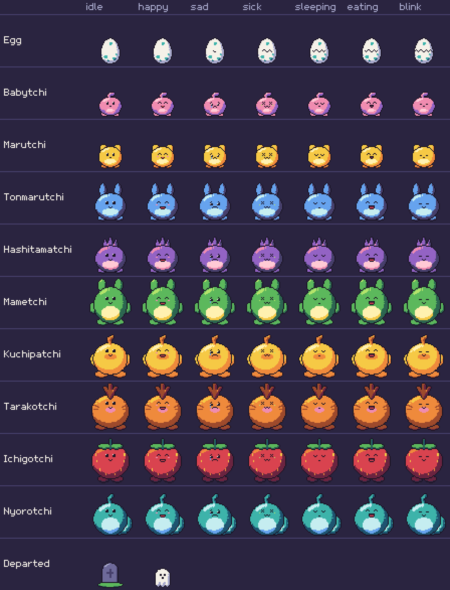

<h1 align="center">tama</h1>

<p align="center"><b>A pixel-art tamagotchi that lives in a window, in your status bar and in your shell.</b></p>

<p align="center">
  
</p>

Hatch an egg, feed it, take it to the toilet, play games with it and raise it into one of five
adults. It keeps living while the game is closed, so check on it from your status bar, get a
desktop notification when it needs you, and let your `git commit`s feed it. Free to play, written
in Rust, drawn in 24 colours.

## Highlights

- **A pet that lives on without you.** Close the game and the pet gets hungry, sleepy and sick at
  a slower, safe pace. Come back to find out how it went.
- **Five adults to raise.** How well you care for the pet decides what it grows into. Collect
  them all in the awards.
- **Mini-games, coins and a shop.** Memory, Pong, Shells and RPS, played by keyboard or mouse. Win coins and
  spend them on treats.
- **Mouse or keyboard.** Every action is a button and a key, and everything clickable lights up
  when you hover it.
- **Lives in your terminal too.** `tama status` for tmux or waybar, `tama feed` from the shell,
  `tama watch` for notifications, and a zsh hook that rewards your commits.
- **Crisp pixels.** One pixel size at any window size, a matching pixel font and a fixed palette.

## Quick start

On 64-bit Linux, one command downloads the game and adds it to your app menu (no Rust needed):

```sh
curl -fsSL https://raw.githubusercontent.com/Olinkkt/tamagotchi/master/install.sh | sh
```

Then search for "tama" in your launcher. It needs `curl` and a desktop with OpenGL. To build it
yourself instead, see Install below.

## Install

You need [Rust](https://rustup.rs) (1.86 or newer) and a desktop with OpenGL. From the
project folder:

```sh
cargo install --path .
```

This puts `tama` in `~/.cargo/bin`, which must be on your `PATH`. After you change the code,
`tama --update` installs the newest version: it rebuilds from the source folder if that is ahead
(needs Rust), otherwise it downloads the newest GitHub release. At start-up the game checks for one too and shows "UPDATE X.Y.Z READY -
PRESS U"; U closes the game, installs it and opens it again (progress is in `update.log` in the data
folder). Nothing installs unless you press U.

On Linux, run `tama --install-desktop` once to add tama to your app menu with an icon, so you can
start it without a terminal. Run it again after moving the `tama` binary.

## Playing

Run `tama` to open the window. One pet at a time; when it dies you can hatch a new egg with `n`.
Every action is also a button along the bottom of the window: click it, or press its key (shown
in the button's corner). The shop, awards, graveyard, game picker and the games have no bar: click their "esc"
button (or, on a card, anywhere off it) to close them. F11 toggles fullscreen.

| Key | Action |
|---|---|
| `f` | feed a meal (+1 hunger heart) |
| `s` | snack (+1 happy heart; makes it heavier, and sometimes sick) |
| `p` | play: pick a mini-game (see below) |
| `m` | medicine (a sick pet needs two doses) |
| `t` | take it to the toilet (when it needs to go) |
| `d` | scold, but only when it is being naughty |
| `b` | shop (see below) |
| `a` | awards: achievements and the adults you have raised |
| `g` | graveyard: the pets you have lost |
| `q` | quit (the pet keeps living) |

The line under the room always tells you the most urgent thing to do, the matching button
bounces in yellow, and the pet shows a bubble with an icon for it. Buttons that would do nothing
right now are dimmed.

### Mini-games

Any game makes the pet a little lighter, and winning makes it happier. A perfect game forgives
one care mistake.

All of them are drawn in the same pixel art as the pet, scores included, and take the full width of
the window while you play (the status panel comes back afterwards). When a game ends, a result
screen shows a star per round won, the coins earned and the pet cheering or sulking for three
seconds (any key skips it).

1. **Memory**: four coloured pads light up in a pattern of 3, 4 and 5; repeat it with keys 1 to 4 (or click the pads). Your pet watches and cheers or sulks.
2. **Pong**: return the ball five times; one miss ends it. Your pet keeps goal on the other side. The paddle moves while you hold ↑/↓ (or W/S, K/J), or while you hold the mouse button, when it chases the pointer; it stops when you let go.
3. **Shells**: your pet hides under one of three cups, then the cups swap places. Pick the cup it is under with keys 1 to 3 (or click it). Three rounds, with more and faster swaps each time.
4. **RPS**: rock paper scissors against your pet. Pick with keys 1 to 3 or R/P/S (or click); both hands shake three times, then show. Win two of three rounds; a tie is played again.

### The toilet

A minute or two after a meal (and rarely out of nowhere) the pet needs the toilet: a bubble appears
and the **Clean** button becomes **Toilet** (`t`). Press it and the view moves to a washroom with
five booths. The pet sits in a random one, the door swings shut, and about five seconds later it
opens and you are back in the room. A pixel dissolve (blocks of ink) shuts and clears the screen at both ends. Snacks do not cause it. If you ignore the call for 10 minutes,
the pet has an accident: Happy -1, a care mistake and a chance of sickness. While the game is
closed the call waits for you and never ends in an accident. `tama toilet` does it from the shell.

### Coins, shop and awards

Winning a mini-game pays **4 coins**, and a perfect game **10**. Spend them in the shop (`b`,
then `1` to `4`, or click an item; the shop closes so you can watch your pet enjoy it); nothing is charged if the item would do nothing right now:

| Item | Price | Effect |
|---|---|---|
| Fancy meal | 8 | +2 hunger, a bit heavy |
| Toy | 6 | +2 happy, burns weight |
| Salad | 5 | +1 hunger, lighter |
| Vitamins | 12 | no sickness for 3 hours |

`a` shows ten achievements (for example "Spotless": reach adulthood with no care mistakes) and
the five adult species, in colour once you have raised one and as a silhouette until then. Coins, achievements and the collection belong
to you, not to one pet, so they survive a pet dying; they live in `profile.json` next to the save.
Prices and rewards are first guesses.

### Growing up

```
Egg -30s-> Baby -10 min-> Child -1 h-> Teen -2 h-> Adult -2 days-> old age
```

Every egg hatches after exactly 30 seconds and shakes in its own pattern, which it keeps through
saves and restarts. It starts out nearly still, then shakes more often, harder and with a tilt;
from 20 seconds a zigzag crack grows across its middle, a bit more on each hard hit (six stages, all
done by 28 seconds). Once it runs all the way across, the top half lifts and rocks on the bottom
half and bits of shell fly off the crack. One last strong shake at 29 seconds, a held breath, a white flash, and it bursts: the baby pops out, the cap flies
off in an arc, and the two halves of the shell stay on the floor for a few seconds.

Care mistakes (counted over its whole life) decide what it grows into:

- Ignoring hunger, unhappiness or sickness for 15 minutes, ignoring a naughty call for
  10 minutes each add one mistake.

| Becoming | Needs |
|---|---|
| Teen: Tonmarutchi | 0 to 2 mistakes |
| Teen: Hashitamatchi | 3 or more |
| Adult: Mametchi | 0 to 1 mistakes **and** 75% discipline |
| Adult: Kuchipatchi | 0 to 2 mistakes |
| Adult: Tarakotchi | 3 to 4 |
| Adult: Ichigotchi | 5 to 6 |
| Adult: Nyorotchi | 7 or more |

Discipline starts at 50% and rises 25 points each time you scold a real naughty call.
The status panel shows what it is on track for.

Each pet also gets a random trait: *greedy* (hungry faster), *playful* (bored faster, +2
happiness from a win), *hardy* (rarely sick), *mischievous* (acts up more) or *easygoing*.
An overweight pet (a heavy snack habit) falls sick three times as often.

The pet sleeps from 22:00 to 07:00 by your clock.

### While the game is closed

The pet is "away". Its needs fall three times slower, hunger and happiness never drop below
one heart, and it cannot fall sick, act up or die. It still grows up. Both rules can be changed
in the config (`away_slowdown`, `away_safe`).

## Commands

Only `tama` and `tama --dev` open a window; everything else runs in the terminal
and loads no graphics, so the status bar and `tama watch` stay light.

```
tama                 play (opens the window)
tama status          one line for a status bar, e.g. (T_T) Marutchi ♡♡♡♡ ♥♥♥♡ ! feed
tama status --waybar JSON for waybar: short text, a hover tooltip, and a class
tama feed|snack|toilet|medicine|scold
                     care for the pet without opening the game (refused while it is open)
tama hook zsh        print a shell snippet so commits feed the pet and failed commands upset it
tama event commit|fail  tell the pet about a shell event (the hook calls this)
tama watch           desktop notifications when the pet needs you
tama watch --test    send one test notification
tama --animate on|off  show or hide the animated ears, wings, tuft, leaves and tail
tama --update | --version | --help
tama --gallery       write tama-gallery.png: every character in every expression (no window)
tama --dev           developer mode (speed keys, separate test save)
```

## Settings

`~/.config/tamagotchi/config.json` is created on first run with every option and its default.
Leave out any you do not want to change. On macOS and Windows the file lives in that system's
usual config folder.

| Option | Meaning |
|---|---|
| `hunger_secs_baby` / `_child` / `_teen` / `_adult` | seconds per lost hunger heart |
| `happy_decay_factor` | happiness falls this many times slower than hunger |
| `urge_after_meal_secs`, `urge_after_meal_extra_secs` | the toilet call comes this many seconds after a meal + random(extra) |
| `urge_odds` | chance of a toilet call out of nowhere: 1 in N per awake second |
| `urge_patience_secs` | an ignored toilet call ends in an accident after this long |
| `sick_odds`, `naughty_odds` | 1 in N per awake second |
| `overweight_sick_factor` | sickness is this many times likelier when heavy |
| `mistake_after_secs` | how long a need may wait before it counts as a mistake |
| `baby_secs`, `child_secs`, `teen_secs`, `adult_lifespan_secs` | stage lengths |
| `sleep_start_hour`, `sleep_end_hour` | sleeping hours, 24h clock |
| `away_slowdown`, `away_safe` | see "While the game is closed" |
| `commit_meal_gap_secs`, `fails_per_sad_heart` | see "Shell hook" |
| `check_updates` | look for a newer version at start-up (asks github.com) |
| `animate_parts` | show and wiggle the ears, wings, tuft, leaves and tail |

The balance numbers are first guesses and not play-tested over many days.

Saves, the profile, the graveyard and a lock file live in the user data folder (`~/.local/share/tamagotchi`
on Linux). Saves are written atomically, and an unreadable save is moved aside instead of
being overwritten.

## Your machine

The pet reacts to how the computer is doing. This is only for show, with no effect on its needs:

| Machine | Pet |
|---|---|
| CPU busy (1-minute load average at 80% of your cores or more) | sweat drops |
| Memory nearly full (85% or more in use) | dizzy, spinning eyes |
| Battery low (20% or less, and discharging) | sleepy eyes and a battery icon |

The status panel and the status-bar tooltip say what is going on. This reads `/proc` and `/sys`,
so it works on Linux; on other systems the pet just never notices. The thresholds are my
guesses. Your own machine can be tried out with the dev panel (`u`, `r`, `b`).

## Shell hook

Add this to `~/.zshrc` (zsh only for now) and your pet notices what you do in the terminal:

```sh
eval "$(tama hook zsh)"
```

- A successful `git commit` feeds it one hunger heart, at most once per 10 minutes.
- Every 5th failed command (Ctrl-C does not count) costs it one happy heart.

The hook only appends a line to a small queue file, so it is instant and works whether or not
the game is open; the game, or the next `tama feed`-style command, applies the queue. Both
numbers are in the config.

## Status bar and notifications

None of this is required to play.

**waybar**: a custom module that runs `tama status --waybar`:

```json
"custom/tama": {
    "exec": "~/.cargo/bin/tama status --waybar",
    "return-type": "json",
    "interval": 10,
    "tooltip": true
}
```

It shows `(^_^)`, adds `!` when the pet needs something, and the tooltip has the details. The
module gets the CSS classes `ok`, `alert`, `dead` and `none`, e.g. `#custom-tama.alert { color: #ff453a; }`.

**tmux** (not tried): `set -g status-right '#(tama status)'`.

**Notifications**: run `tama watch` in the background (for example `exec-once = tama watch` in
Hyprland, or a systemd user service). It checks every 30 seconds, notifies about the most
urgent need, repeats an unanswered one after 10 minutes, and stays quiet while the game is
open. It uses `notify-send` on Linux (tested) and `osascript` on macOS (written, never run),
and sends them under the app name `tama`. To show only tama's notifications in mako, end its
config with:

```ini
[expiring]
invisible=1

[!expiring]
invisible=1

[app-name=tama]
invisible=0
```

## Development

```sh
cargo test        # unit tests; file tests run in a temporary folder
tama --dev        # separate test save; press Tab for the dev panel
cargo art         # redraw every sprite into assets/ (tools/spritegen)
```

The dev panel shows the value behind every dev key. It changes hunger/happy/discipline/weight/
mistakes, makes it need the toilet, sickness or a naughty call, adds coins, steps through every form (← →,
or `[` `]`, including death), cracks the egg, grows or kills the pet, skips time and sets the clock, changes
the speed (x1, 2, 5, 10, 60, 600 with `f`, and `1` for straight back to x1), and switches the machine reactions (CPU, RAM, battery) on and off. Clicking a button
always does the action, even while the panel is open.

Shift+R (then `y`) throws the current pet away and starts a new egg.

### Pixel art

Everything is drawn with the 24 colours in `src/palette.rs`; nothing uses colours outside it.
`cargo art` builds the sprites: each character is drawn in shapes on a 128x128 canvas,
rasterised without anti-aliasing, shrunk with nearest-neighbour to 32x32 (baby, child), 40x40
(teens) or 48x48 (adults), snapped to the palette, shaded from the top left with hue-shifted
palette ramps, and given a 1px outline. Faces, egg cracks and icons are exact pixel grids
(`src/faces.rs`, `src/icons.rs`). Ears, wings, the tuft, leaves and tail are separate three-frame
layers, drawn only with `animate_parts` on. The sheets in `assets/sprites/` are embedded in the
binary; `assets/preview/` gets an 8x preview of every sprite (not committed).

Source layout:

| File | What it holds |
|---|---|
| `main.rs` | picks a shell command or opens the window |
| `app.rs` | game state, keys, clicks, the dev panel's keys |
| `window.rs` | the macroquad window: scaling, input, drawing text at full resolution |
| `hud.rs` | the screen around the room: header, hint line, button bar |
| `panel.rs` | the status panel |
| `scene.rs` | the room: the pet, its moods and reactions, bubbles, effects |
| `toilet.rs` | the washroom visit: booths, the door and the timing |
| `screens.rs` | the cards: game picker, shop, awards, graveyard, reset |
| `games.rs` | mini-games and the result screen |
| `frame.rs` | the palette pixel canvas everything is drawn into |
| `art.rs` | the embedded sprite sheets |
| `palette.rs`, `faces.rs`, `cast.rs` | colours, face grids, sprite sheet layout (shared with `tools/spritegen`) |
| `icons.rs`, `font.rs` | small pixel icons and the pixel font |
| `gallery.rs` | `--gallery` |
| `pet.rs` | the simulation: needs, growth, evolution, shop items |
| `profile.rs` | coins, achievements, the adult collection |
| `cli.rs` | shell commands, `--flags`, status bar, notifications, `--update` |
| `update.rs` | finds the newest version (local folder or GitHub release) and installs it |
| `save.rs` | save files (with a format `version`), profile, graveyard, lock |
| `sysinfo.rs` | machine load |
| `config.rs` | settings |

New mini-games should draw a palette `Frame` like the existing ones, with the pet's own
sprite; scores are pixels too, not text.

Versions follow `MAJOR.MINOR.PATCH`; see `CLAUDE.md` for the rules.

## Licence

Tama is free to play, but it is not open source. You may play it, build it from this source for
your own use and share the link to this repository. You may not sell it, redistribute modified
copies or use its art and code in other projects. See [LICENSE](LICENSE) for the full terms.
